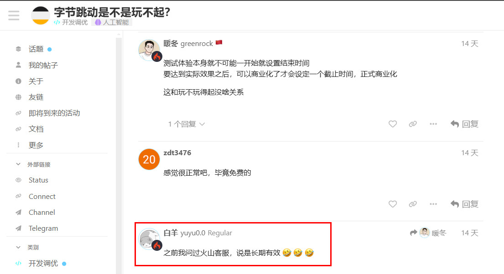
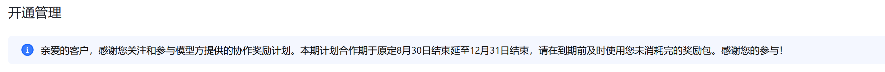

# 大语言模型服务价格汇总

2024年5月，各大模型厂商打起了“价格战”，意图拉拢更多开发者参与应用开发和模型落地探索。本仓库用于收集各大云服务厂商的大语言模型服务价格，方便用户对比。价格单位按照输入/输出每百万词元（Token）需要花费的人民币价格进行计算，美元到人民币汇率按最近一年的平均汇率7.0计算。

本仓库只是一个速查表，更详细的信息请参考各个厂商的官方价格文档。例如闲时价格、预付费价格、Batch调用价格等。

由于最近一年不同厂商的免费试用权益变动较多，获得免费权益的门槛变动也多，有效期也短，因此本仓库不收集免费试用权益包信息。

**统计模型和平台范围**：
- 只选取应用较为广泛，使用的应用数和人数较多，较为典型和具有代表性的模型和平台。以及服务价格较为便宜的平台。
- 由于本速查表主要面向翻译和中英双语应用，对于闭源且不支持中文（例如LLaMa系列）或中文支持较差的模型（例如微软的Phi系列）不会被纳入统计。
- 如果某开源模型在其官方平台已经十分便宜，那第三方平台的价格不会被纳入统计。
- 主要面向企业用户，个人用户难以申请使用的平台和模型不会被纳入统计。
- 在官方出了新模型且新模型性能提升较大，且价格相较旧模型更便宜或者持平的情况下，不再额外统计旧模型。（例如只统计LLaMa3不统计LLaMa2）
- 官方宣布即将被弃用的模型，或者描述为Older/Legacy的模型不会被纳入统计。
- 由于模型太小和/或性能不佳，连一篇完整新闻文章都翻译不下来的模型（例如qwen1.5-0.5b-chat）不会被纳入统计。
- 存在多个阶梯定价的模型（通常是按照上下文长度定价），我们统计16K~24K输入长度附近的定价，这通常是非Agent任务的常见长度区间。

**统计数据范围**：
- 模型提供平台及定价页面
- API调用格式是否兼容OpenAI格式
- 审查情况（要求翻译 [BBC政治新闻](https://www.bbc.com/news/world-asia-66727459) 检查是否存在截断和拒绝回复的情况）。
- 价格

注：
- 由于上下文窗口现在对非Agent任务都足够大，所以不再统计各模型的上下文窗口大小。
- 由于LORA微调在使用前沿开源模型的情况下，服务这一过程的许多算力平台和框架都相对成熟，且随着Agent的发展，微调的必要性现在已越来越小。依赖闭源平台微调的需要也越来越少，因此不再统计模型微调价格。

## GPT系列
模型提供平台：[OpenAI](https://platform.openai.com/docs/pricing/) / [Azure](https://azure.microsoft.com/zh-cn/pricing/details/cognitive-services/openai-service/)（定价基本一致）

API是否兼容OpenAI格式：OpenAI的天然兼容；Azure的有自定义格式，不兼容

审查情况：无审查

价格：

最后更新日期：2026-02-24

通用闭源大模型定价：

| **模型** | **文本模态输入价格（元/M Tokens）** | **文本模态输出价格（元/M Tokens）** | **备注** |
| :---: | :---: | :---: | :---: |
| gpt-5.2 | 12.25 | 98 | |
| gpt-5.1 | 8.75 | 70 | |
| gpt-5-mini | 1.75 | 14 | |
| gpt-5-nano | 0.35 | 2.8 | |

TTS/ASR/OCR 模型定价：

| **模型** | **估算每小时音频消耗费用（元）** | **备注** |
| :---: | :---: | :---: |
| gpt-4o-mini-tts | 6.3 | |
| gpt-4o-transcribe | 2.52 | |
| gpt-4o-transcribe-diarize | 2.52 | |
| gpt-4o-mini-transcribe | 1.26 | |

开源模型定价：

| **模型** | **文本模态输入价格（元/M Tokens）** | **文本模态输出价格（元/M Tokens）** | **备注** |
| :---: | :---: | :---: | :---: |
| gpt-oss-120b | 0.273 | 1.33 | 报价平台：Deepinfra |

备注：openai官方平台推出了Flex processing功能，以牺牲速度和可用率为代价，降低了推理价格，和Batch调用的价格一致（打五折）。适合对时间不敏感的任务。

## Claude系列
模型提供平台： [Anthropic](https://docs.anthropic.com/en/docs/models-overview#model-comparison) / [AWS](https://aws.amazon.com/cn/bedrock/pricing/) 价格类似

API是否兼容OpenAI格式：否，自定义格式

审查情况：无审查

价格：

最后更新日期：2026-02-24

| **模型**      | **输入价格（元/M Tokens）** | **输出价格（元/M Tokens）** | **备注** |
|:-----------:|:--------------------:|:--------------------:|:------:|
| Claude Opus 4.6 | 35 | 175 |  |
| Claude Sonnet 4.6 | 21 | 105 |  |
| Claude Haiku 4.5 | 7 | 35 |  |

注：Claude命中缓存后的输入价格将降至普通输入的1折，但是存储缓存消息需要额外支付存储费用。详见[文档](https://docs.anthropic.com/zh-CN/docs/build-with-claude/prompt-caching)。

## Gemini系列
模型提供平台： [谷歌](https://ai.google.dev/gemini-api/docs/pricing?hl=zh-cn) / [openrouter](https://openrouter.ai/models?arch=Gemini) （注：openrouter也是调用的谷歌的API，但是是一个大池子，价格同步谷歌官方）

API是否兼容OpenAI格式：是，见[谷歌官方文档](https://ai.google.dev/gemini-api/docs/openai?hl=zh-cn)

审查情况：无审查

**谷歌官方平台随用随付**方案价格

最后更新日期：2026-02-25

| **模型**      | **输入价格（元/M Tokens）** | **输出价格（元/M Tokens）** | **备注** |
|:-----------:|:--------------------:|:--------------------:|:------:|
| gemini-3.1-pro-preview | 14 | 84 | |
| gemini-3-pro-preview | 14 | 84 | |
| gemini-3-flash-preview | 3.5 | 21 | |
| gemini-2.5-pro | 8.75 | 70 | |
| gemini-2.5-flash | 2.1 | 17.5 | |
| gemini-2.5-flash-lite | 0.7 | 2.8 | |

注：Gemini的提示缓存为1折，缓存消息另有存储费用。详见[文档](https://ai.google.dev/gemini-api/docs/caching?lang=python&hl=zh-cn)。

## Gemma系列
模型提供平台： [谷歌](https://ai.google.dev/pricing) / [DeepInfra](https://deepinfra.com/google/gemma-3-27b-it) 等

API是否兼容OpenAI格式：开源模型，大多数部署平台支持OpenAI格式

审查情况：无审查

价格：

最后更新日期：2026-02-25

| **模型**      | **输入价格（元/M Tokens）** | **输出价格（元/M Tokens）** | **上下文窗口大小（K）** | **备注** |
|:-----------:|:--------------------:|:--------------------:|:--------------:|:------:|
| gemma-3-27b-it | 0.56 | 1.12 | 128 | DeepInfra报价 |

## Grok系列
模型提供平台： [x.ai](https://docs.x.ai/docs/models)

API是否兼容OpenAI格式：是

审查情况：无

价格：

最后更新日期：2026-02-25

| **模型**      | **输入价格（元/M Tokens）** | **输出价格（元/M Tokens）** | **备注** |
|:-----------:|:--------------------:|:--------------------:|:------:|
| grok-4-1-fast-reasoning | 1.4 | 3.5 | grok-4价格相同 |
| grok-4-1-fast-non-reasoning | 1.4 | 3.5 | grok-4价格相同 |

注：Grok的缓存输入价格为2.5折。即Grok4.1的缓存输入价格为0.35元/M Tokens。Batch API打五折。

## GLM系列
模型提供平台： [智谱AI](https://open.bigmodel.cn/pricing)

API是否兼容OpenAI格式：兼容，参见[文档](https://open.bigmodel.cn/dev/api#openai_sdk)。

审查情况：平台对API输出有审查，参见[审查文档](https://open.bigmodel.cn/dev/howuse/securityaudit)。但是z.ai（海外服务平台）是否存在审查未知。

价格：

最后更新日期：2026-02-25

| **模型**      | **输入价格（元/M Tokens）** | **输出价格（元/M Tokens）** | **备注** |
|:-----------:|:--------------------:|:--------------------:|:------:|
| GLM-5 | 4 | 18 |  |
| GLM-4.7 | 3 | 14 |  |
| GLM-4.6V | 1 | 3 |  |
| GLM-4.5-Air | 0.8 | 6 |  |
| GLM-4.7-FlashX | 0.5 | 3 |  |
| GLM-4.6V-FlashX | 0.15 | 1.5 |  |
| GLM-4-Air-250414 | 0.5 | 0.5 |  |
| GLM-Z1-FlashX | 0.1 | 0.1 |  |
| GLM-4-FlashX-250414 | 0.1 | 0.1 |  |
| GLM-4.7-Flash | 0 | 0 | 免费的有并发限制 |
| GLM-4.6V-Flash | 0 | 0 | 免费的有并发限制 |
| GLM-4-Flash-250414 | 0 | 0 | 免费的有并发限制 |
| GLM-Z1-Flash | 0 | 0 | 免费的有并发限制 |

此外，ASR/TTS/OCR模型价格：
| **模型** | **价格** | **备注** |
| :---: | :---: | :---: |
| GLM-OCR | 0.2元/百万Tokens | 相当于1元可处理约 2000 张 A4 大小扫描图片或 200 份 10 页简单排版PDF |
| GLM-TTS | 2元/万字符 | GLM-TTS-Clone的音色克隆功能6元/次 |
| GLM-ASR-2512 | 输入：16元/百万 tokens | 约0.72元/小时，输出不计费 |

注：
- 高校师生认证后有[优惠](https://open.bigmodel.cn/university)。
- Batch API打5折。
- 缓存命中打2~2.5折。

## Deepseek系列
模型提供平台： [deepseek官方开放平台](https://api-docs.deepseek.com/zh-cn/quick_start/pricing)

API是否兼容OpenAI格式：是

审查情况：平台对API输出有审查

价格：

最后更新日期：2026-02-25

| **模型**      | **输入价格（元/M Tokens）** | **输出价格（元/M Tokens）** | **备注** |
|:-----------:|:--------------------:|:--------------------:|:------:|
| deepseek-chat | 2 | 3 | 缓存命中打1折 |
| deepseek-reasoner | 2 | 3 | 缓存命中打1折 |

注：
1. 注意：deepseek-chat 和 deepseek-reasoner 对应模型版本截止更新时为 DeepSeek-V3.2 (128K 上下文长度)，与 APP/WEB 版不同（是在进行灰度测试的新模型）。
2. 字节火山引擎、硅基流动等定价与deepseek官网大致相同；部分平台的售价低于官方价格，也是有可能的。
3. 其他推理平台，例如国外的inference-net可能略低于官方定价，且没有输出后置审查，但可能没有前缀缓存功能。

## Mistral系列
模型提供平台： [mistral](https://mistral.ai/pricing#api)

API是否兼容OpenAI格式：是

审查情况：无审查

价格：

最后更新日期：2026-02-25

| **模型**      | **输入价格（元/M Tokens）** | **输出价格（元/M Tokens）** | **备注** |
|:-----------:|:--------------------:|:--------------------:|:------:|
| mistral-large-latest | 3.5 | 10.5 |  |
| mistral-medium-latest | 2.8 | 14 |  |
| mistral-small-latest | 0.7 | 2.1 |  |

备注：
1. mistral可以欧元支付，因汇率因素与美元支付略有差异。
2. Batch API打5折。
3. 暂不支持前缀缓存。

## 腾讯混元系列
模型提供平台： [腾讯云](https://cloud.tencent.com/document/product/1729/97731)

API是否兼容OpenAI格式：是，参见[腾讯云文档](https://cloud.tencent.com/document/product/1729/111007)

审查情况：有审查，参见[腾讯云API文档中错误码部分](https://cloud.tencent.com/document/product/1729/101847)

价格：

最后更新日期：2026-02-25

| **模型**      | **输入价格（元/M Tokens）** | **输出价格（元/M Tokens）** | **备注** |
|:-----------:|:--------------------:|:--------------------:|:------:|
| Tencent HY 2.0 Think | 3.975 | 15.9 |  |
| Tencent HY 2.0 Instruct | 3.18 | 7.95 |  |

注：不支持前缀缓存和Batch API。

## 阿里千问系列
模型提供平台： [阿里云百炼](https://help.aliyun.com/zh/model-studio/model-pricing) / [openrouter](https://openrouter.ai/models) / [AIPing](https://aiping.cn/modelList)

API是否兼容OpenAI格式：是，参见[阿里云文档](https://help.aliyun.com/zh/model-studio/qwen-api-via-openai-chat-completions)；[openrouter文档](https://openrouter.ai/docs/quickstart#requests)；[AIPing文档](https://aiping.cn/docs/PlatformOverview/product)

审查情况：开源模型本身不存在审查；境外算力平台对输入输出普遍无审查；阿里云平台存在审查，见[文档](https://help.aliyun.com/zh/model-studio/error-code)

以下价格选自阿里云百炼官方平台（大部分千问模型支持前缀缓存）的报价：

最后更新日期：2026-02-25

| **模型**      | **输入价格（元/M Tokens）** | **输出价格（元/M Tokens）** | **备注** |
|:-----------:|:--------------------:|:--------------------:|:------:|
| qwen3-max | 2.5 | 10 |  |
| qwen3.5-plus | 0.8 | 4.8 |  |
| qwen3.5-flash | 0.2 | 2 |  |
| Qwen3.5-397B-A17B | 1.2 | 7.2 |  |
| Qwen3.5-122B-A10B | 0.8 | 6.4 |  |
| qwen3.5-27b | 0.6 | 4.8 |  |
| qwen3.5-35b-a3b | 0.4 | 3.2 |  |

注：
1. 不同平台的上下文缓存使用方法和折扣有所不同，例如阿里云百炼的缓存有显式缓存和隐式缓存两种，折扣分别为1折和2折，且支持的模型列表也不同，详见[官方文档](https://help.aliyun.com/zh/model-studio/context-cache)。Batch API同理。
2. 千问系列模型还有很多其他功用的模型，例如TTS/ASR等。在此不一一列举。

## 字节豆包系列
模型提供平台： [字节跳动火山引擎](https://www.volcengine.com/docs/82379/1544106)

API是否兼容OpenAI格式：否，自定义格式

审查情况：存在**多重审查（输入审查/模型内置审查/输出审查）**，见[官方文档错误码](https://www.volcengine.com/docs/82379/1299023)，搜索“敏感”

价格：**豆包/字节/火山引擎 存在商业诚信问题，无论性价比多高，都不建议使用。详见下面的说明。**

2024年年中，字节旗下的火山推出了一个活动：加入协作者计划，同意将对话数据分享给豆包用于模型训练后，就能获得5亿Tokens的推理额度。
当时有不少人，通过工单等形式，同火山的客服确认了，赠送的5亿Tokens的推理额度是「永久使用，没有时间限制」的。
然而，2024年12月，火山突然以短信和站内横幅通知宣布，该计划赠送的5亿Tokens的推理额度只能使用到2024年12月31日，之后就会失效。
不少人发送工单确认了这个消息。
从这个事情可以看出，火山的商业诚信问题值得您留意，一些事先承诺的事情很容易轻易变卦，并且不给用户时间和补偿。
因此不建议使用，否则有可能变得不幸。

相关截图：

[相关讨论](https://linux.do/t/topic/279855)

本仓库作为受害者之一，不再建议各位使用豆包闭源模型，考虑到其模型严重的审查和一般的性价比，市场上存在更好的选择。

最后更新日期：2026-02-26

| **模型**      | **输入价格（元/M Tokens）** | **输出价格（元/M Tokens）** | **备注** |
|:-----------:|:--------------------:|:--------------------:|:------:|
| doubao-seed-2.0-pro | 3.2 | 16 |  |
| doubao-seed-2.0-lite | 0.6 | 3.6 |  |
| doubao-seed-2.0-mini | 0.2 | 2.0 |  |

## 文心Ernie系列
模型提供平台： [百度千帆大模型平台](https://cloud.baidu.com/doc/qianfan/s/wmh4sv6ya)

API是否兼容OpenAI格式：否，自定义格式

审查情况：对输出存在审查。

价格：

最后更新日期：2026-02-26

| **模型**      | **输入价格（元/M Tokens）** | **输出价格（元/M Tokens）** | **备注** |
|:-----------:|:--------------------:|:--------------------:|:------:|
| ERNIE 5.0 | 6 | 24 | 无上下文缓存功能 |

## Kimi系列
模型提供平台： [moonshot开放平台](https://platform.moonshot.cn/docs/pricing/chat#%E4%BA%A7%E5%93%81%E5%AE%9A%E4%BB%B7)

API是否兼容OpenAI格式：是，参见[文档](https://platform.moonshot.cn/docs/guide/migrating-from-openai-to-kimi)

审查情况：未测试，未知

价格：

最后更新日期：2026-02-26

| **模型**      | **输入价格（元/M Tokens）** | **输出价格（元/M Tokens）** | **备注** |
|:-----------:|:--------------------:|:--------------------:|:------:|
| kimi-k2.5 | 4 | 21 | 缓存命中0.7元 |
| kimi-k2-0905-preview | 4 | 16 | 缓存命中1元 |
| kimi-k2-thinking | 4 | 16 | 缓存命中1元 |

## minimax系列
模型提供平台： [minimaxi国内站](https://platform.minimaxi.com/docs/guides/pricing-paygo) / [minimaxi国际站](https://platform.minimax.io/docs/guides/pricing-paygo)

API是否兼容OpenAI格式：是

审查情况：国际站点的API未知；国内存在审查。

价格：

最后更新日期：2026-02-26

| **模型**      | **输入价格（元/M Tokens）** | **输出价格（元/M Tokens）** | **备注** |
|:-----------:|:--------------------:|:--------------------:|:------:|
| MiniMax-M2.5 | 2.1 | 8.4 | 缓存读取一折，但是缓存写入存在费用，价格为2.625元/MTokens |

## 小米Mimo系列
模型提供平台： [小米Mimo官方平台](https://platform.xiaomimimo.com/#/docs/pricing) 等

API是否兼容OpenAI格式：是

审查情况：开源模型本身不存在审查，但官方面向国内的服务存在审查。

价格：

最后更新日期：2026-02-26

| **模型**      | **输入价格（元/M Tokens）** | **输出价格（元/M Tokens）** | **备注** |
|:-----------:|:--------------------:|:--------------------:|:------:|
| mimo-v2-flash | 0.7 | 2.1 | 输入缓存1折 |

## 阶跃星辰系列
模型提供平台： [阶跃星辰官方平台](https://platform.stepfun.com/docs/pricing/details) 等

API是否兼容OpenAI格式：是

审查情况：开源模型本身不存在审查，但官方面向国内的服务存在审查。

价格：

最后更新日期：2026-02-26

| **模型**      | **输入价格（元/M Tokens）** | **输出价格（元/M Tokens）** | **备注** |
|:-----------:|:--------------------:|:--------------------:|:------:|
| step-3.5-flash | 0.7 | 2.1 | 输入缓存2折 |
| step-3 | 4 | 10 | 输入缓存2折 |

## 模板
模型提供平台：  /  / 

API是否兼容OpenAI格式：

审查情况：

价格：

最后更新日期：YYYY-MM-DD

| **模型**      | **输入价格（元/M Tokens）** | **输出价格（元/M Tokens）** | **备注** |
|:-----------:|:--------------------:|:--------------------:|:------:|
|  |  |  |  |  |
|  |  |  |  |  |
|  |  |  |  |  |

## 其他

- 由于看不懂讯飞星火的定价策略和接口调用，故没有收录。
- 零一万物系列已事实上接近退出竞争市场，故不再收录。
- Cohere系列已事实上落伍，故不再收录。
- 蚂蚁百灵团队的Ring、Ling系列相较Kimi系列没有性价比，且无特色，暂不收录。
- 美团Longcat暂时处于公测阶段不支持付费购买推理额度，暂不收录。
